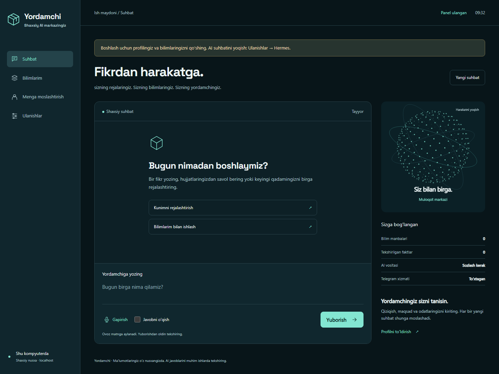
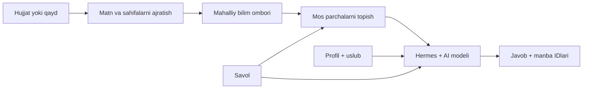
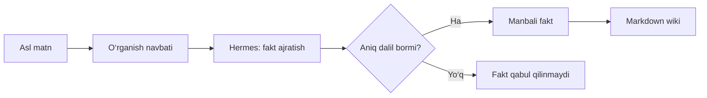
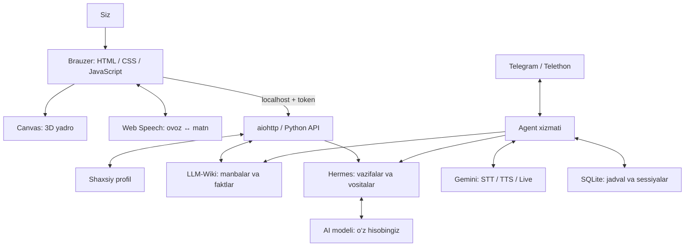

<div align="center">

# Yordamchi

### Sizni tushunadigan shaxsiy AI markazingiz

**O‘zbekcha · Brauzerda · Shaxsiy xotira · Ovoz · 3D panel**

[Boshlash](#tez-boshlash) · [Shaxsiylashtirish](#ozingizga-moslashtirish) · [Texnologiyalar](#ichkarida-nima-ishlaydi) · [Dars rejasi](docs/dars-rejasi.md) · [Maxfiylik](SECURITY.md)



</div>

Yordamchi — har kim **o‘z kompyuteriga, o‘z hisoblari bilan** o‘rnatadigan shaxsiy assistent. Suhbatlashing, hujjatlaringizni qo‘shing, ma’lumotni manbasi bilan toping va javob uslubini o‘zingizga moslang. Ixtiyoriy Telegram moduli xabarlar, qo‘ng‘iroqlar va eslatmalarni qo‘shadi.

> **Eng oson yo‘l:** repozitoriyni yuklab oling → `install.cmd`ni oching → profilingizni kiriting. Panel va mahalliy bilim qidiruvi uchun Telegram, API kaliti yoki pulli hisob kerak emas. AI suhbatiga Hermes va o‘zingizning AI hisobingiz ulanadi.

## Birinchi marta ochyapsizmi?

1. [**Loyihani ZIP qilib yuklang**](https://github.com/xamidjonovk/yordamchi/archive/refs/heads/main.zip) va arxivni to‘liq oching.
2. **Windows:** `install.cmd`ni ikki marta bosing. **macOS/Linux:** ochilgan papkada terminaldan `bash scripts/install-web.sh`ni bajaring. Kutubxonalar o‘rnatilib, panel brauzerda ochiladi.
3. **Menga moslashtirish**da profilingizni yozing, **Bilimlarim**da birinchi qaydni saqlang. AI bilan javoblashish uchun pastdagi [AI ulash bosqichini](#ai-suhbatini-ulash) bajaring.

Keyingi safar Windows’da `start-web.cmd`, macOS/Linux’da `.venv/bin/hpa web` bilan ochasiz. Birinchi o‘rnatish vaqtida terminalni yopmang. Telegram ulashni keyinroq bajarish mumkin.

## Imkoniyatlar

| Imkoniyat | Nima kerak? | Natija |
|---|---|---|
| Web panel, 3D yadro, profil | Installer tayyorlaydigan Python muhiti | Brauzerda shaxsiy boshqaruv markazi |
| Matn/hujjat saqlash va qidirish | Mahalliy disk | Manba IDsi va tegishli matn |
| AI suhbat va topshiriqlar | Hermes + o‘z ChatGPT/Codex hisobingiz | Profil va bilimlarga tayangan javob |
| Brauzerda gapirish | Mos brauzer, mikrofon ruxsati | Gap matnga aylanadi; tekshirib yuborasiz |
| Javobni ovozda o‘qish | Brauzerdagi mavjud ovoz | Matn ovozda o‘qiladi |
| Telegram va jonli qo‘ng‘iroq | `calls`, alohida inson akkaunti, Telegram API, Gemini kaliti | Telegram orqali matn va ovoz |
| Avtomatik fakt ajratish, eslatmalar | Ishlayotgan Telegram xizmati + Hermes | Manbali bilimlar va doimiy jadval |

3D yadro XYZ nuqtalarini perspektivada chizadi; tashqi CDN yoki kuchli GPU kerak emas. U tizim yuklanishi grafigi emas. Haqiqiy ulanish holati yonidagi matnda ko‘rsatiladi.

## Tez boshlash

Internet, brauzer, 4 GB yoki ko‘proq RAM va kutubxonalar uchun bo‘sh disk joyi tayyor bo‘lsin. Python **3.11–3.13** qo‘llanadi; installer 3.11 ni tayyorlaydi. Birinchi yuklash internet tezligiga bog‘liq. Administrator huquqi odatda kerak emas.

### 1. GitHub’dan oling

[**ZIPni yuklab olish**](https://github.com/xamidjonovk/yordamchi/archive/refs/heads/main.zip) → arxivni to‘liq oching → `yordamchi-main` papkasiga kiring. Arxiv ichidan bevosita ishga tushirmang. Yoki Git bilan:

```bash
git clone https://github.com/xamidjonovk/yordamchi.git
cd yordamchi
```

Bu buyruqlar loyihani `yordamchi` papkasiga yuklaydi. Git bo‘lmasa, yuqoridagi ZIP usuli yetarli.

### 2. Panelni o‘rnating

| Windows | macOS / Linux |
|---|---|
| **`install.cmd`**ni ikki marta bosing | Terminalda `bash scripts/install-web.sh` |
| Qayta ochish: **`start-web.cmd`** | Qayta ochish: `.venv/bin/hpa web` |


<details>
<summary>Terminal orqali muqobil usul</summary>

Windows PowerShell:

```powershell
powershell -NoProfile -ExecutionPolicy Bypass -File .\scripts\install-web.ps1
```

uv allaqachon o‘rnatilgan bo‘lsa, barcha tizimlarda:

```bash
uv sync --frozen --python 3.11
uv run hpa web
```

Brauzerni avtomatik ochmaslik: `uv run hpa web --no-browser`.
Port band bo‘lsa: `uv run hpa web --port 8790`.

</details>

### 3. Birinchi natijani oling

1. **Menga moslashtirish**: ism, til, vaqt zonasi va maqsadingizni yozing.
2. **Bilimlarim**: `Dars jadvali` sarlavhasi bilan `Python darsi juma kuni 18:00 da` qaydini saqlang.
3. Qidiruvga `Python` yozing. Matn va manba IDsi ko‘rinishi kerak.
4. AI ulanganidan so‘ng: `Python darsim qachon? Manbani ko‘rsat.` deb so‘rang.

Panel `http://127.0.0.1:8787`da ishlaydi. Terminaldagi **to‘liq shaxsiy havola** kirish uchun kerak; undagi tokenni ulashmang. Server qayta boshlansa, yangi havola yaratiladi. Brauzerni yopish serverni to‘xtatmaydi; terminalda **Ctrl+C** bosing.

## AI suhbatini ulash

Vazifalar Hermes orqali `openai-codex` hisob ulanishiga yuboriladi. Hisobingizda mavjud modelni tanlang; obuna limitlari va provayder shartlari amal qiladi. Bu yo‘nalish OpenAI API kalitini talab qilmaydi. Hech qanday hisob yoki obuna repo bilan tarqatilmaydi.

1. [Rasmiy qo‘llanma](https://hermes-agent.nousresearch.com/docs/getting-started/installation) bo‘yicha Hermes’ni o‘rnating. To‘liq loyiha installerlarida mahkamlangan Hermes commitidan foydalaniladi.
2. O‘z hisobingizni ulang va loyiha ko‘nikmasini o‘rnating:

```bash
hermes auth add openai-codex --no-browser
hermes auth status openai-codex
uv run hpa install-skill
```

3. **Menga moslashtirish → Hermes modeli**ga hisobingizdagi model nomini kiriting.
4. `uv run hpa web` bilan panelni qayta ochib oddiy savol yuboring.

**Hermes topildi** faqat dastur mavjudligini bildiradi; login yoki model ishlashi haqiqiy javob orqali tasdiqlanadi. Login kodi va parollarni faqat rasmiy login oynasiga kiriting. Model mavjudligi va xarajatlar foydalanuvchi hisobiga bog‘liq.

Hermes vositalar va fayllar bilan ishlay oladi. Topshiriqni aniq yozing; hujjat ichidagi begona ko‘rsatmalar yangi ruxsat hisoblanmaydi. Tashqi amal haqiqiy natija bilan tasdiqlanmaguncha bajarilgan deb hisoblamang.

## Ovoz bilan ishlash

**Gapirish** → mikrofonga ruxsat → matnni tekshirish → **Yuborish**. Mikrofonni to‘xtatish: **Tugatish**. **Javobni o‘qish** belgilansa javob brauzer ovozida o‘qiladi.

Ovozni tanish [hamma brauzerda bir xil ishlamaydi](https://developer.mozilla.org/en-US/docs/Web/API/SpeechRecognition). Chrome/Edge’da sinash mumkin; mavjudlik tizim, til va xizmatga bog‘liq. Brauzer audioni o‘z serveriga yuborishi mumkin. O‘zbekcha ovoz yo‘q bo‘lsa matn rejimidan foydalaning. Web panel navbatma-navbat ovozli suhbat qiladi; uzluksiz jonli audio Telegram qo‘ng‘iroqlari modulida.

## Telegram va jonli qo‘ng‘iroqlar

Bu qism **ixtiyoriy**. Asosiy akkauntingizdan boshqa **inson Telegram akkaunti** kerak; BotFather boti shaxsiy qo‘ng‘iroq o‘rnini bosmaydi. API ID/hash: [my.telegram.org](https://my.telegram.org). Ovoz uchun o‘z Gemini kalitingiz kerak; uning API sarfi AI obunangizdan alohida.

Windows’da to‘liq installer:

```powershell
powershell -NoProfile -ExecutionPolicy Bypass -File .\scripts\install.ps1
```

Linux yoki mos Apple Silicon Mac:

```bash
bash scripts/install.sh
```

Oldin tayyorlangan muhitda:

```bash
uv sync --frozen --extra calls
uv run --extra calls hpa setup
uv run --extra calls hpa doctor
uv run --extra calls hpa start
uv run --extra calls hpa web
```

**uv qo‘shimchalarni olib tashlashi mumkin:** qo‘ng‘iroq rejimida `uv run --extra calls ...`ni ishlating yoki `.venv` ichidagi `hpa`ni to‘g‘ridan-to‘g‘ri chaqiring. [uv sinxronlash qoidalari](https://docs.astral.sh/uv/concepts/projects/sync/).

Sozlash ustasi: ism → vaqt zonasi → Gemini kaliti → AI login → Telegram API → telefon → login kodi → asosiy akkaunt username’i. Har bir o‘quvchi **faqat o‘z ma’lumotlarini** kiritadi. Kalitlarni `.env.example`ga yozmang.

`hpa status` haqiqiy holatni ko‘rsatadi; `hpa start` qaytishi faqat boshlash so‘ralganini bildiradi. `hpa stop` to‘xtatadi. Uyqudagi kompyuter eslatma bajara olmaydi. Bir Telegram sessiyasini ikki kompyuterda bir vaqtda ishlatmang.

| Tizim / rejim | Moslik |
|---|---|
| Web panel | Windows, Linux, macOS; asosiy paketda native qo‘ng‘iroq kutubxonasi yo‘q |
| Telegram ovozi | `ntgcalls` uchun mos platforma/wheel kerak |
| Intel Mac qo‘ng‘iroqlari | Mahkamlangan native kutubxona cheklangan; Linux Docker yo‘lidan foydalaning |
| Docker | `docker compose run --rm agent setup`, keyin `docker compose up -d`; standart Compose Telegram uchun, web port ochmaydi |
| Eski native desktop | Ixtiyoriy `desktop` paketi; yangi foydalanuvchi uchun web panel qulayroq |

Yangi o‘zgarishlar Windows’da tekshirilgan. Linux/macOS uchun CI matritsasi bor; bu ish davomida ularning haqiqiy qurilmalarida yangi tekshiruv bajarilmadi. Telefon brauzeriga LAN orqali ulanish hozirgi localhost serverining imkoniyati emas.

## O‘zingizga moslashtirish

### Profil: doimiy kontekst

| Maydon | Yaxshi misol | Vazifasi |
|---|---|---|
| Ism | O‘z ismingiz | Yordamchi kimga xizmat qilishini biladi |
| Tanishtirish | `Men sizning shaxsiy AI yordamchingizman.` | Matn va ovozda tanishtirish |
| Uslub | `Avval qisqa javob ber, keyin misol keltir.` | Javob ohangi va batafsilligi |
| Kontekst | `Python o‘rganaman, kuniga 30 daqiqam bor.` | Vazifalarga qo‘shiladigan maqsadlar |
| Til / zona | O‘zbekcha / `Asia/Tashkent` | Javob tili va vaqt talqini |

Saqlagach **Yangi suhbat**ni boshlang. Ishlayotgan Telegram xizmatini qayta boshlang. Profilga parol, karta yoki API kaliti yozmang.

### Bilimlar: shaxsiy hujjatlar

**Bilimlarim** orqali qayd, TXT, MD, matnli PDF, DOCX, PPTX, XLSX, CSV/TSV qo‘shing. Web limiti **10 MB**. Skanerlangan PDF/rasmlar uchun avval OCR kerak. Makrolar va hujjat kodi bajarilmaydi.

Ko‘p faylni terminaldan qo‘shish:

```bash
uv run hpa memory ingest "MENING_HUJJATLARIM"
uv run hpa memory stats
uv run hpa memory search "loyiha muddati"
uv run hpa memory source MANBA_ID
```

Papkani ataylab tanlang; butun uy papkasini yoki parollar saqlangan joyni indekslamang. Namuna fayllar va mashqlar: [shaxsiylashtirish qo‘llanmasi](docs/shaxsiylashtirish.md).

### “O‘qitish” qanday ishlaydi?

Bu yerda model vaznlari qayta o‘qitilmaydi. **RAG** — savolga mos bilimni topib, modelga javob oldidan berish — va manbali wiki ishlatiladi.



Misol: `Loyiha 20-dekabrda tugaydi` qaydini qo‘shing, keyin muddatni so‘rang. Javobdagi manbani tekshiring. Sana o‘zgarsa sanasi ko‘rsatilgan yangi qayd kiriting; qarama-qarshi faktlar bo‘lsa qaysi biri amaldaligini aniq ayting.

**Avtomatik o‘rganish:** Telegram xizmati va Hermes ishlaganda yangi manbalardan dalilli fakt va bog‘lanishlar ajratiladi. `Ulanishlar` orqali yoqiladi/o‘chiriladi. Web panelning o‘zi fon fakt ajratishni boshlamaydi; oddiy matn qidiruvi esa darhol ishlaydi.



Bir qaydda bir mavzu, aniq sana, tushunarli sarlavha va haqiqiy dalil ishlating. **Qidiruvdan chiqarish** manba va faktlarni keyingi qidiruvdan chiqaradi, fizik o‘chirmaydi: raw fayl, jurnal, oldingi suhbat va backuplar qolishi mumkin.

## Ichkarida nima ishlaydi?



| Texnologiya | Qanday ishlaydi va nima qiladi? |
|---|---|
| **Python** | API, agent, fayl, jadval va CLI’ni birlashtiradi. |
| **uv + uv.lock** | Python va kutubxonalarni belgilangan versiyada o‘rnatadi. |
| **aiohttp + asyncio** | Web so‘rov va tarmoq kutishlarini boshqaradi. |
| **HTML / CSS / JavaScript** | Tuzilish, ko‘rinish va interaksiyalar; Node/React build kerak emas. |
| **Canvas + 3D matematika** | XYZ nuqtalarini aylantirib, perspektivada tekis ekranga chizadi. |
| **Web Speech API** | Brauzerda gapni matnga, javobni ovozga aylantiradi. |
| **Hermes** | Model, suhbat tarixi, ko‘nikma va amaliy vositalarni bog‘laydi. |
| **ChatGPT/Codex hisob ulanishi** | `openai-codex` orqali o‘z AI hisobingizdan foydalanadi. |
| **Google GenAI / Gemini** | Telegram’dagi jonli ovoz, transkripsiya va ovoz yaratish. |
| **Telethon** | Telegram inson akkaunti sessiyasi, chat va xabarlarni boshqaradi. |
| **py-tgcalls / ntgcalls** | Telegram qo‘ng‘iroq transporti; ixtiyoriy native kutubxonalar. |
| **NumPy / soxr / FFmpeg** | Audio massivlari, chastota moslash va audio formatlar. |
| **LLM-Wiki / Markdown / JSON** | Asl manba, dalilli fakt, bog‘lanish va o‘qiladigan bilim sahifalari. |
| **SQLite** | Alohida server talab qilmaydigan jadval va sessiya bazasi; eski xotirani migratsiya qilish. |
| **pypdf / openpyxl / XML / ZIP** | PDF, Excel, Word va PowerPoint’dan matn va sahifa ma’lumotini ajratadi. |
| **platformdirs / dotenv / tzdata** | OSga mos shaxsiy papka, tashqi kalitlar va vaqt zonalari. |
| **filelock / psutil** | Parallel yozuvlar va xizmat processlarini boshqaradi. |
| **pywebview** | Eski desktop panelni native oynada ochadigan ixtiyoriy paket. |
| **Docker / Compose** | Server uchun dastur va kutubxonalarni bir muhitda yig‘adi. |
| **pytest / Playwright / GitHub Actions** | Backend, xavfsizlik, brauzer va OS tekshiruvlari. |

`semantic` / FastEmbed — eski SQLite qidiruvi uchun meros qo‘shimchasi. **Hozirgi faol WikiKnowledge qidiruvi kalit so‘z asosida ishlaydi**, vektor qidiruvi emas. Juda katta kolleksiyalarda JSON manifestini o‘qish va qidirish sekinlashishi mumkin. [Batafsil arxitektura](docs/architecture.md).

## Ma’lumotlar qayerda?

| Tizim | Standart shaxsiy papka |
|---|---|
| Windows | `%LOCALAPPDATA%\HermesPersonalAgent` |
| Linux | `~/.local/share/HermesPersonalAgent` |
| macOS | `~/Library/Application Support/HermesPersonalAgent` |

Aniq joy: `hpa doctor`. `HPA_HOME` bilan o‘zgartirish mumkin; repo tashqarisidagi alohida papkani tanlang. Hermes loginlari o‘z `HERMES_HOME` papkasida qoladi.

```text
Shaxsiy papka/                ← GitHub’ga yuborilmaydi
├── config.json               ← Profil va afzalliklar
├── .env                      ← Shaxsiy API kaliti
├── data/
│   ├── telegram.session      ← Maxfiy sessiya
│   ├── telegram.json         ← Telegram credentiallari
│   ├── scheduler.sqlite3     ← Rejalar va vazifalar
│   └── vault/
│       ├── raw/              ← Asl manbalar
│       ├── wiki/             ← Bilim sahifalari
│       ├── journal/          ← O‘zgarishlar
│       └── manifest.json     ← Manba va faktlar ro‘yxati
└── inbox/                    ← Telegram xizmati kuzatadigan fayllar
```

**Mahalliy saqlash hammasi offline degani emas:** savol, profil va tegishli manba parchalari AI provayderiga; Telegram ovozi Gemini’ga; brauzer ovozi brauzer xizmatiga yuborilishi mumkin. Diskdagi bilimlar shifrlanmagan.

Zaxira olish:

```bash
uv run hpa backup "SHAXSIY_BACKUP.zip"
uv run hpa stop
uv run hpa restore "SHAXSIY_BACKUP.zip"
```

Backup login credentiallarini olmaydi, lekin profil, hujjat va suhbat bilimlari shaxsiy. Uni GitHub’ga yubormang. Restore mavjud ma’lumotni almashtirishi mumkin: avval backup oling, xizmatni to‘xtating. Credentiallarni ham ko‘chiradigan `export-private` vositasini dars arxivi uchun ishlatmang.

## Muammolar va yechimlar

| Belgisi | Yechim |
|---|---|
| 401 / kirish havolasi kerak | `hpa web` bergan to‘liq yangi havolani oching. |
| uv topilmadi | Installer yoki [uv rasmiy qo‘llanmasi](https://docs.astral.sh/uv/getting-started/installation/); terminalni qayta oching. |
| Port band | `hpa web --port 8790`. |
| Hermes topilmadi | Rasmiy installni tugating; zarur bo‘lsa `HERMES_BIN`da executable yo‘lini bering. |
| AI javob bermadi | Login, model va limitni tekshiring. Tashqi amal bajarilgan-bajarilmaganini bilmay turib qaytarmang. |
| Mikrofon ishlamadi | Brauzer ruxsati/mosligini tekshiring yoki matn yozing. |
| PDF bo‘sh | Matnli PDF yoki OCR natijasini yuklang. |
| Faktlar soni oshmadi | Telegram xizmati, Hermes login va learning kerak; oddiy qidiruv uchun matnning o‘zi yetadi. |
| Qo‘ng‘iroq kutubxonasi yo‘q | `uv sync --frozen --extra calls`; mos platformadan foydalaning. |
| Telegram ishlamayapti | `hpa doctor`; bir sessiyaning ikkinchi nusxasi ishlamayotganini tekshiring. |

## Dasturchi va dars o‘tuvchi uchun

```bash
uv sync --frozen --extra dev --extra calls
uv run --extra dev --extra calls pytest -q
uv run --extra dev playwright install chromium
uv run --extra dev python scripts/verify-web-ui.py
uv run --extra dev python -m build
python scripts/privacy_scan.py
python scripts/privacy_scan.py --history
python scripts/build_release.py
```

Tarqatma: `dist/hermes-personal-agent-0.4.0.zip` va `.sha256`. Yig‘ishdan oldin maxfiylik skani ishlaydi; arxivga `.git` va shaxsiy papkalar kirmaydi. Skan inson tekshiruvini to‘liq almashtirmaydi.

Eski tarixda shaxsiy ma’lumot bo‘lsa, uni ommaviy qilmang. Yangi tarixli nusxa:

```bash
python scripts/export_public.py "YANGI_BOSH_PAPKA"
```

Buyruq ko‘rib chiqilgan fayllardan yangi repo va shaxsiy Git muallif ma’lumotlarisiz birinchi commit yaratadi. GitHub’ga o‘zi yubormaydi; eski private tarixni o‘zgartirmaydi. Yangi nusxani ko‘rib chiqqach o‘zingiz yaratgan GitHub repoga ulang.

[90 daqiqalik dars](docs/dars-rejasi.md) · [Shaxsiylashtirish mashqlari](docs/shaxsiylashtirish.md) · [Tekshiruv holati](docs/validation.md)

---

MIT litsenziyasi. Har bir ishtirokchi o‘z hisobi, kaliti, ma’lumoti va provayder xarajatlarini o‘zi boshqaradi.
