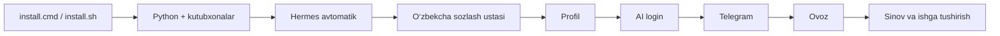
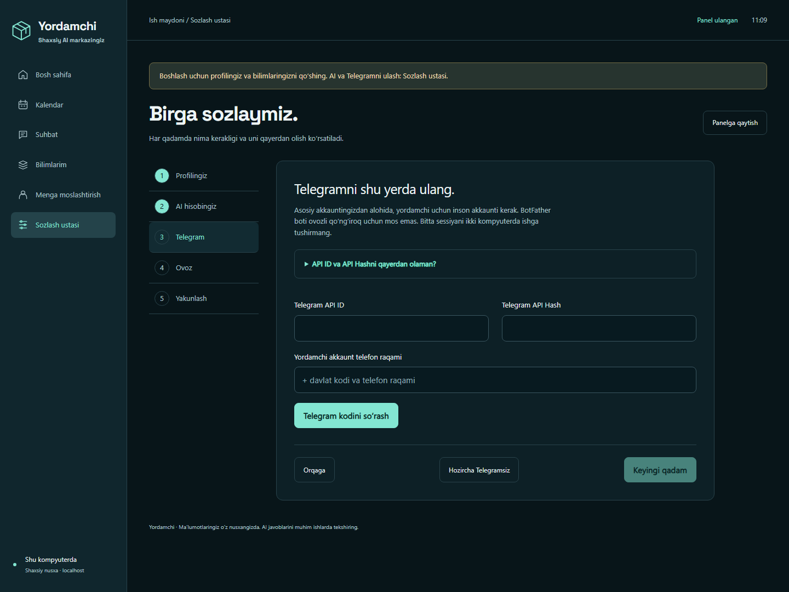
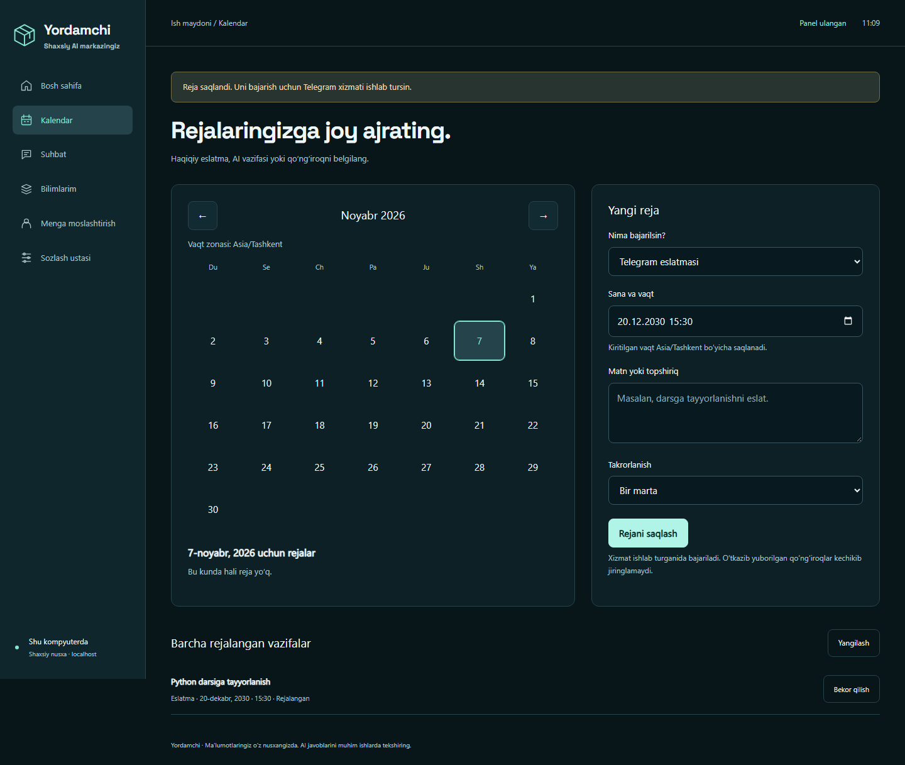
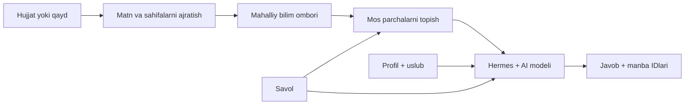
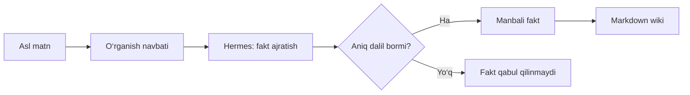
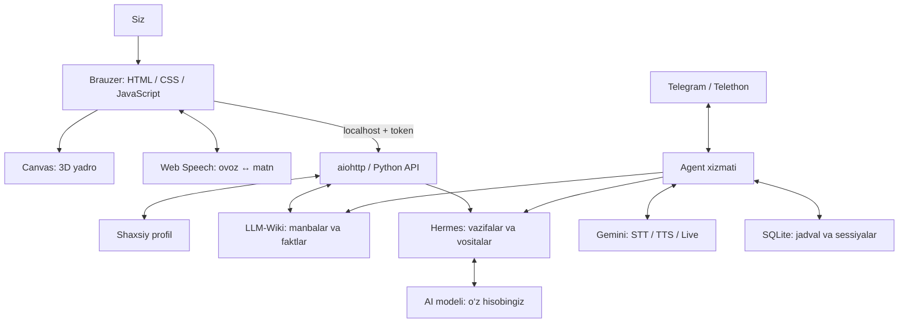

<div align="center">

# Yordamchi

### Bitta installer. O‘zbekcha sozlash ustasi. Shaxsiy AI markazingiz.

**Hermes avtomatik · OpenAI yoki Claude · Telegram · Ovoz · Kalendar · Shaxsiy bilimlar**

[O‘rnatish](#birinchi-marta-ornatish) · [Sozlash qadamlari](#sozlash-ustasining-5-qadami) · [Web panel](#web-panelda-nimalar-bor) · [Dars rejasi](docs/dars-rejasi.md)


</div>

Yordamchi har kim o‘z kompyuteriga, o‘z hisoblari bilan o‘rnatadigan assistent. **Hermes’ni alohida o‘rnatish yoki Telegramni terminaldan ulash talab qilinmaydi.** Installer Python, kutubxonalar va Hermes’ni tayyorlaydi, keyin brauzerda o‘zbekcha sozlash ustasini ochadi.

Rasmlardagi vazifa va xabarlar — sun’iy dars misollari, haqiqiy shaxsiy yozishmalar emas.

## Birinchi marta o‘rnatish

1. [**ZIPni yuklab oling**](https://github.com/xamidjonovk/yordamchi/archive/refs/heads/main.zip).
2. ZIPni **to‘liq oching** va `yordamchi-main` papkasiga kiring.
3. **Windows:** `install.cmd`ni ikki marta bosing. **macOS/Linux:** shu papkada terminaldan `bash scripts/install.sh`ni bajaring.
4. O‘rnatish tugashini kuting. **Brauzerda sozlash ustasi avtomatik ochiladi.** Oynani yopmang; birinchi o‘rnatish yuklash tezligiga qarab bir necha daqiqa yoki ko‘proq vaqt olishi mumkin.
5. Ustadagi qadamlarni bajarib **Keyingi qadam**ni bosing. Qayerdan nima olish har qadam ichida tushuntirilgan.

Git bilan olishni xohlasangiz:

```bash
git clone https://github.com/xamidjonovk/yordamchi.git
cd yordamchi
```

Internet, brauzer, kutubxona va Hermes vositalari uchun bir necha GB bo‘sh disk joyi kerak. Python 3.11 ni installer o‘zi tayyorlaydi. Native qo‘ng‘iroqlar Windows x64, mos Linux va Apple Silicon muhitidagi kutubxonalarga bog‘liq; Intel Mac uchun tanlangan ntgcalls versiyasida cheklov bor. Installer provayder hisobini sizning o‘rningizga yaratmaydi.



## Sozlash ustasining 5 qadami

| Qadam | Nima qilasiz? | Usta qanday yordam beradi? |
|---|---|---|
| **1. Profilingiz** | Ism, vaqt zonasi va javob uslubini yozasiz | O‘zbekcha yorliqlar va misollar |
| **2. AI hisobingiz** | OpenAI yoki Claude tanlaysiz; rasmiy loginni tasdiqlaysiz | Rasmiy havola va vaqtinchalik kod shu oynada ko‘rinadi; boshqa provayderga o‘tsangiz ulanish qayta tekshiriladi |
| **3. Telegram** | API ID/hash, yordamchi telefon raqami, kelgan kod, kerak bo‘lsa 2FA paroli va asosiy username | my.telegram.org’da qayerga kirish va nimani ko‘chirish bo‘yicha ochiladigan yo‘riqnoma |
| **4. Ovoz** | Brauzer ovozi yoki Gemini jonli ovozini tanlaysiz | Mikrofon/ovoz sinovi, Gemini kalitini qayerdan olish va tekshirish |
| **5. Yakunlash** | AI javobini sinaysiz, muhim xabar qoidalarini tanlaysiz, xizmatni boshlaysiz | Model haqiqiy javob bermaguncha yakunlash ochilmaydi; xizmatning haqiqiy holati bosh sahifada ko‘rsatiladi |



### OpenAI hisobini ulash

**AI hisobingiz → OpenAI — ChatGPT / Codex**ni tanlang. **Hisobni ulash**ni bosing. Usta ko‘rsatgan rasmiy OpenAI sahifasini ochib, vaqtinchalik kodni o‘sha yerga kiriting. Login tugagach **Keyingi qadam** ochiladi. Hisobingizda ruxsat etilgan Codex modelini tanlang; provayder limitlari amal qiladi. Parolingiz bu panelga kiritilmaydi.

### Claude hisobini ulash

**Anthropic — Claude Max + qo‘shimcha kreditlar**ni tanlang va ko‘rsatilgan shartni o‘qing. Hermes’ning joriy OAuth yo‘li **Claude Max va sotib olingan qo‘shimcha foydalanish kreditlarini** talab qiladi. Oddiy Pro yoki Max’ning bazaviy limiti yetarli emas; qo‘shimcha sarf Anthropic hisobingizdan olinadi. [Rasmiy provayder shartlari](https://hermes-agent.nousresearch.com/docs/integrations/providers).

Rasmiy login sahifasi bergan vaqtinchalik tasdiqlash kodini usta ichiga kiriting. OAuth credentiallari shaxsiy nusxangizda saqlanadi. Modelni hisobingizda mavjud nomga moslang, masalan `claude-sonnet-4-6`. Usta hech qachon OpenAI xatosida o‘zicha boshqa pulli provayderga o‘tmaydi.

### Telegram uchun nimalar kerak?

Asosiy akkauntingizdan **alohida inson Telegram akkaunti**. BotFather boti jonli qo‘ng‘iroq o‘rnini bosmaydi. Ustada **API ID va API Hashni qayerdan olaman?**ni oching: telefon bilan [my.telegram.org](https://my.telegram.org/auth) → **API development tools** → ilova yaratish → ID/hashni ko‘chirish qadamlari bor.

Kod odatda Telegram ilovasidagi xizmat xabariga keladi. Ikki bosqichli parol yoqilgan bo‘lsa keyingi maydon paydo bo‘ladi. Oxirida **o‘zingizning asosiy @username’ingizni** ko‘rsatasiz; eslatmalar shu akkauntga yuboriladi. Uni yordamchi akkaunt kontaktiga qo‘shib qo‘ying. Xato username’ni tuzatib qayta tasdiqlash mumkin.

Hozir ikkinchi akkaunt yoki Telegram API ma’lumoti bo‘lmasa **Hozircha Telegramsiz**ni tanlab, AI va bilimlar bilan ishlash mumkin. Telegramni keyin **Sozlash ustasi**dan ulang. Bitta Telegram sessiyasini bir vaqtda ikki qurilmada ishga tushirmang.

### Ovoz tanlovi

- **Brauzer ovozi:** alohida API kalitisiz panelda gapni matnga aylantirish va javobni o‘qish. Mikrofon ruxsati va o‘zbekcha talaffuz brauzer/tizimga bog‘liq. Brauzer audioni o‘z xizmatiga yuborishi mumkin. Telegram bu rejimda matn bilan ishlaydi.
- **Gemini:** Telegram ovozli xabarlari va jonli qo‘ng‘iroq. Ustada [Google AI Studio](https://aistudio.google.com/apikey)dan kalit olish tushuntiriladi. Kalit va modelga kirish tekshiriladi. API sarfi OpenAI/Claude obunasidan **alohida**, Google hisobingizga hisoblanadi.

Ovoz/Gemini kaliti ulanishi haqiqiy jonli qo‘ng‘iroq sifati tekshirildi degani emas. Ulangach o‘zingiz sinov qo‘ng‘irog‘ini bajaring.

## Web panelda nimalar bor?

| Bo‘lim | Vazifasi |
|---|---|
| **Bosh sahifa** | Yaqinlashayotgan ishlar, yangi muhim xabarlar va xizmat holati; Telegramni boshlash/to‘xtatish |
| **Kalendar** | Oy ko‘rinishi, kunni tanlash, Telegram eslatmasi, AI vazifasi yoki qo‘ng‘iroq rejalash; bir marta/kunlik/haftalik takror va bekor qilish |
| **Suhbat** | Profil va bilimlarga tayangan AI muloqoti; mikrofon va javobni ovozda o‘qish; 3D yadro |
| **Bilimlarim** | Qayd, hujjat, qidiruv va manbalarni boshqarish |
| **Menga moslashtirish** | Til, uslub, maqsad, tanishtirish va model |
| **Sozlash ustasi** | Hisob, Telegram va ovozni bir oqimda ulash yoki qayta sozlash |



Kalendar va eslatmalar **profilingizdagi vaqt zonasi** bilan saqlanadi. Xizmat o‘chiq bo‘lsa reja saqlanadi, ammo bajarilmaydi. O‘tkazib yuborilgan qo‘ng‘iroqlar kechikib jiringlamaydi. Rejalangan AI vazifasi hisobingiz limitidan foydalanadi.

**Muhim xabarlar:** usta yakunida tanlangan kalit so‘zlar (`muhim`, `shoshilinch` va boshqalar) yoki siz tilga olingan yangi xabarlar panelga tushadi. **Telegramdan yangilash** o‘qilmagan xabarlardan cheklangan miqdorda olib keladi; ularni Telegram’da o‘qilgan deb belgilamaydi. **Ko‘rildi** faqat paneldagi belgini o‘zgartiradi. Bu barcha chatlarning to‘liq tarixi yoki mukammal AI saralashi emas.

## Keyingi safar qanday ochaman?

Windows’da **`start-web.cmd`**. macOS/Linux’da loyiha papkasidan **`.venv/bin/hpa web`**. Qayta sozlash uchun paneldagi **Sozlash ustasi**ni oching; hisoblarni almashtirishdan oldin bosh sahifada ishlayotgan Telegram xizmatini to‘xtating.

Panel `127.0.0.1:8787`da ishlaydi, shaxsiy kirish havolasi terminalda chiqadi. Port band bo‘lsa `.venv` ichidagi `hpa web --port 8790`ni ishlating. Brauzerni yopish serverni to‘xtatmaydi; terminalda **Ctrl+C**. Doimiy eslatmalar uchun Telegram xizmati va kompyuter ishlashi kerak.

## O‘zingizga moslashtirish

### Profil: doimiy kontekst

| Maydon | Yaxshi misol | Vazifasi |
|---|---|---|
| Ism | O‘z ismingiz | Yordamchi kimga xizmat qilishini biladi |
| Tanishtirish | `Men sizning shaxsiy AI yordamchingizman.` | Matn va ovozda tanishtirish |
| Uslub | `Avval qisqa javob ber, keyin misol keltir.` | Javob ohangi va batafsilligi |
| Kontekst | `Python o‘rganaman, kuniga 30 daqiqam bor.` | Vazifalarga qo‘shiladigan maqsadlar |
| Til / zona | O‘zbekcha / `Asia/Tashkent` | Javob tili va vaqt talqini |

Saqlagach **Yangi suhbat**ni boshlang. Ishlayotgan Telegram xizmatini qayta boshlang. Profilga parol, karta yoki API kaliti yozmang.

### Bilimlar: shaxsiy hujjatlar

**Bilimlarim** orqali qayd, TXT, MD, matnli PDF, DOCX, PPTX, XLSX, CSV/TSV qo‘shing. Web limiti **10 MB**. Skanerlangan PDF/rasmlar uchun avval OCR kerak. Makrolar va hujjat kodi bajarilmaydi.

Ko‘p faylni terminaldan qo‘shish:

```bash
uv run --extra calls hpa memory ingest "MENING_HUJJATLARIM"
uv run --extra calls hpa memory stats
uv run --extra calls hpa memory search "loyiha muddati"
uv run --extra calls hpa memory source MANBA_ID
```

Papkani ataylab tanlang; butun uy papkasini yoki parollar saqlangan joyni indekslamang. Namuna fayllar va mashqlar: [shaxsiylashtirish qo‘llanmasi](docs/shaxsiylashtirish.md).

### “O‘qitish” qanday ishlaydi?

Bu yerda model vaznlari qayta o‘qitilmaydi. **RAG** — savolga mos bilimni topib, modelga javob oldidan berish — va manbali wiki ishlatiladi.



Misol: `Loyiha 20-dekabrda tugaydi` qaydini qo‘shing, keyin muddatni so‘rang. Javobdagi manbani tekshiring. Sana o‘zgarsa sanasi ko‘rsatilgan yangi qayd kiriting; qarama-qarshi faktlar bo‘lsa qaysi biri amaldaligini aniq ayting.

**Avtomatik o‘rganish:** Telegram xizmati va Hermes ishlaganda yangi manbalardan dalilli fakt va bog‘lanishlar ajratiladi. `config.json`dagi `learning_enabled` orqali boshqariladi. Web panelning o‘zi fon fakt ajratishni boshlamaydi; oddiy matn qidiruvi esa darhol ishlaydi.



Bir qaydda bir mavzu, aniq sana, tushunarli sarlavha va haqiqiy dalil ishlating. **Qidiruvdan chiqarish** manba va faktlarni keyingi qidiruvdan chiqaradi, fizik o‘chirmaydi: raw fayl, jurnal, oldingi suhbat va backuplar qolishi mumkin.

## Ichkarida nima ishlaydi?



| Texnologiya | Qanday ishlaydi va nima qiladi? |
|---|---|
| **Python** | API, agent, fayl, jadval va CLI’ni birlashtiradi. |
| **uv + uv.lock** | Python va kutubxonalarni belgilangan versiyada o‘rnatadi. |
| **aiohttp + asyncio** | Web so‘rov va tarmoq kutishlarini boshqaradi. |
| **HTML / CSS / JavaScript** | Tuzilish, ko‘rinish va interaksiyalar; Node/React build kerak emas. |
| **Canvas + 3D matematika** | XYZ nuqtalarini aylantirib, perspektivada tekis ekranga chizadi. |
| **Web Speech API** | Brauzerda gapni matnga, javobni ovozga aylantiradi. |
| **Hermes** | Model, suhbat tarixi, ko‘nikma va amaliy vositalarni bog‘laydi. |
| **OpenAI / Anthropic OAuth** | Tanlangan hisobga rasmiy login; credentiallar alohida Hermes profilida. Claude yo‘li Max + qo‘shimcha kreditlarni talab qiladi. |
| **Google GenAI / Gemini** | Telegram’dagi jonli ovoz, transkripsiya va ovoz yaratish. |
| **Telethon** | Telegram inson akkaunti sessiyasi, chat va xabarlarni boshqaradi. |
| **py-tgcalls / ntgcalls** | Telegram qo‘ng‘iroq transporti; ixtiyoriy native kutubxonalar. |
| **NumPy / soxr / FFmpeg** | Audio massivlari, chastota moslash va audio formatlar. |
| **LLM-Wiki / Markdown / JSON** | Asl manba, dalilli fakt, bog‘lanish va o‘qiladigan bilim sahifalari. |
| **SQLite** | Alohida server talab qilmaydigan jadval va sessiya bazasi; eski xotirani migratsiya qilish. |
| **pypdf / openpyxl / XML / ZIP** | PDF, Excel, Word va PowerPoint’dan matn va sahifa ma’lumotini ajratadi. |
| **platformdirs / dotenv / tzdata** | OSga mos shaxsiy papka, tashqi kalitlar va vaqt zonalari. |
| **filelock / psutil** | Parallel yozuvlar va xizmat processlarini boshqaradi. |
| **pywebview** | Eski desktop panelni native oynada ochadigan ixtiyoriy paket. |
| **Docker / Compose** | Server uchun dastur va kutubxonalarni bir muhitda yig‘adi. |
| **pytest / Playwright / GitHub Actions** | Backend, xavfsizlik, brauzer va OS tekshiruvlari. |

`semantic` / FastEmbed — eski SQLite qidiruvi uchun meros qo‘shimchasi. **Hozirgi faol WikiKnowledge qidiruvi kalit so‘z asosida ishlaydi**, vektor qidiruvi emas. Juda katta kolleksiyalarda JSON manifestini o‘qish va qidirish sekinlashishi mumkin. [Batafsil arxitektura](docs/architecture.md).

## Ma’lumotlar qayerda?

| Tizim | Standart shaxsiy papka |
|---|---|
| Windows | `%LOCALAPPDATA%\HermesPersonalAgent` |
| Linux | `~/.local/share/HermesPersonalAgent` |
| macOS | `~/Library/Application Support/HermesPersonalAgent` |

Aniq joy: `hpa doctor`. `HPA_HOME` bilan o‘zgartirish mumkin; repo tashqarisidagi alohida papkani tanlang. Hermes loginlari o‘z `HERMES_HOME` papkasida qoladi.

```text
Shaxsiy papka/                ← GitHub’ga yuborilmaydi
├── config.json               ← Profil va afzalliklar
├── .env                      ← Shaxsiy API kaliti
├── data/
│   ├── telegram.session      ← Maxfiy sessiya
│   ├── telegram.json         ← Telegram credentiallari
│   ├── scheduler.sqlite3     ← Rejalar va vazifalar
│   └── vault/
│       ├── raw/              ← Asl manbalar
│       ├── wiki/             ← Bilim sahifalari
│       ├── journal/          ← O‘zgarishlar
│       └── manifest.json     ← Manba va faktlar ro‘yxati
└── inbox/                    ← Telegram xizmati kuzatadigan fayllar
```

**Mahalliy saqlash hammasi offline degani emas:** savol, profil va tegishli manba parchalari AI provayderiga; Telegram ovozi Gemini’ga; brauzer ovozi brauzer xizmatiga yuborilishi mumkin. Diskdagi bilimlar shifrlanmagan.

Zaxira olish:

```bash
uv run --extra calls hpa backup "SHAXSIY_BACKUP.zip"
uv run --extra calls hpa stop
uv run --extra calls hpa restore "SHAXSIY_BACKUP.zip"
```

Backup login credentiallarini olmaydi, lekin profil, hujjat va suhbat bilimlari shaxsiy. Uni GitHub’ga yubormang. Restore mavjud ma’lumotni almashtirishi mumkin: avval backup oling, xizmatni to‘xtating. Credentiallarni ham ko‘chiradigan `export-private` vositasini dars arxivi uchun ishlatmang.

## Muammolar va yechimlar

| Belgisi | Yechim |
|---|---|
| 401 / kirish havolasi kerak | `hpa web` bergan to‘liq yangi havolani oching. |
| uv topilmadi | Installer yoki [uv rasmiy qo‘llanmasi](https://docs.astral.sh/uv/getting-started/installation/); terminalni qayta oching. |
| Port band | `hpa web --port 8790`. |
| Hermes topilmadi | Rasmiy installni tugating; zarur bo‘lsa `HERMES_BIN`da executable yo‘lini bering. |
| AI javob bermadi | Login, model va limitni tekshiring. Tashqi amal bajarilgan-bajarilmaganini bilmay turib qaytarmang. |
| Mikrofon ishlamadi | Brauzer ruxsati/mosligini tekshiring yoki matn yozing. |
| PDF bo‘sh | Matnli PDF yoki OCR natijasini yuklang. |
| Faktlar soni oshmadi | Telegram xizmati, Hermes login va learning kerak; oddiy qidiruv uchun matnning o‘zi yetadi. |
| Qo‘ng‘iroq kutubxonasi yo‘q | `uv sync --frozen --extra calls`; mos platformadan foydalaning. |
| Telegram ishlamayapti | `hpa doctor`; bir sessiyaning ikkinchi nusxasi ishlamayotganini tekshiring. |

## Dasturchi va dars o‘tuvchi uchun

```bash
uv sync --frozen --extra dev --extra calls
uv run --extra dev --extra calls pytest -q
uv run --extra dev --extra calls playwright install chromium
uv run --extra dev --extra calls python scripts/verify-web-ui.py
uv run --extra dev --extra calls python -m build
python scripts/privacy_scan.py
python scripts/privacy_scan.py --history
python scripts/build_release.py
```

Tarqatma: `dist/hermes-personal-agent-0.5.0.zip` va `.sha256`. Yig‘ishdan oldin maxfiylik skani ishlaydi; arxivga `.git` va shaxsiy papkalar kirmaydi. Skan inson tekshiruvini to‘liq almashtirmaydi.

Eski tarixda shaxsiy ma’lumot bo‘lsa, uni ommaviy qilmang. Yangi tarixli nusxa:

```bash
python scripts/export_public.py "YANGI_BOSH_PAPKA"
```

Buyruq ko‘rib chiqilgan fayllardan yangi repo va shaxsiy Git muallif ma’lumotlarisiz birinchi commit yaratadi. GitHub’ga o‘zi yubormaydi; eski private tarixni o‘zgartirmaydi. Yangi nusxani ko‘rib chiqqach o‘zingiz yaratgan GitHub repoga ulang.

[90 daqiqalik dars](docs/dars-rejasi.md) · [Shaxsiylashtirish mashqlari](docs/shaxsiylashtirish.md) · [Tekshiruv holati](docs/validation.md)

---

MIT litsenziyasi. Har bir ishtirokchi o‘z hisobi, kaliti, ma’lumoti va provayder xarajatlarini o‘zi boshqaradi.
